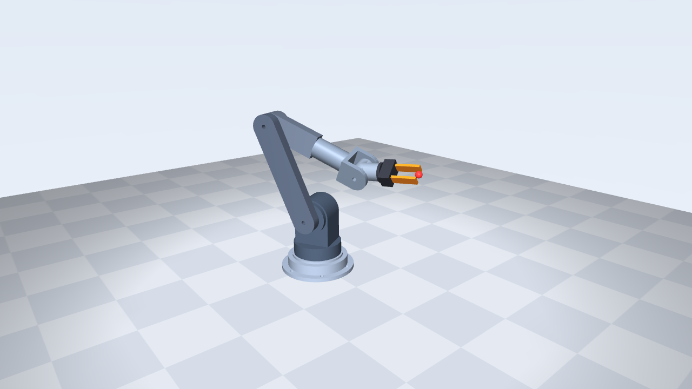

# Adaptive control of a 6-axis arm in MuJoCo: from classical control to learned policies

A 6-axis arm with a gripper, modelled from my own FreeCAD CAD (masses, centres of mass and inertias taken from the CAD) and simulated in
MuJoCo. The project walks through four control approaches on the same pick-and-place task and compares them **honestly**, with
multiple seeds, a tuned baseline, sensor noise, control delay and model mismatch.



## What is in it

| Stage | What | Headline result (details in `results/` and the write-ups) |
|---|---|---|
| 1. Classical | PD, PD+gravity, PID, computed torque (CT), CT+integral, MPC, on 540 random episodes | CT+I is best on tracking; MPC is 8-9x slower and not better |
| 2. Hybrid | CT + a small neural network that learns the missing torque, trained live | Large gain over a *weak* 20 rad/s baseline; **does not beat a tuned 60 rad/s baseline** |
| 3. History + adaptation | Network with a memory of recent model error; Slotine-Li adaptive law | Good inside its parameter family; adaptive law fails with control delay |
| 4. Learning end to end | Imitation (DAgger) then PPO on top of the tuned controller, randomised delay / payload / damping / friction | **100% success, 5.4 s instead of 12.5 s**, works under 10 ms delay; places 4.6 mm off instead of 0.3 mm |

### Stage 1: tracking error (rms joint error, mrad; nominal / varied / stress)

| Controller | Nominal | Varied | Stress |
|---|---|---|---|
| PD | 30.8 | 39.7 | 70.0 |
| PD + gravity | 2.9 | 12.4 | 39.6 |
| PID | 3.2 | 4.7 | 17.4 |
| Computed torque (20 rad/s) | 6.2 | 32.9 | 101.1 |
| Computed torque + integral (20 rad/s) | 0.7 | 3.0 | 25.5 |
| MPC | 10.0 | 52.5 | 163.2 |

### The fair-comparison finding (read this before trusting any "learning beats control" claim)

Stages 2 and 3 first looked like large wins for the networks and the adaptive law, but those were measured against a computed-torque
controller at 20 rad/s bandwidth. Raising it to **60 rad/s** cut post-change error from 7.5 to 0.7 mrad, and against that baseline:

* the networks help a little on payload-type changes at zero delay (heavy 2 kg payload: 0.32 vs 1.01 mrad), are worse on friction, and
  are worse with 10 ms of control delay;
* the adaptive law is good inside its parameter family and fails in every episode with 10 ms of delay;
* above 60 rad/s the plain controller itself goes unstable with 4-10 ms of delay.

So the tuned 60 rad/s controller is the reference everything else is judged against, and stage 4 uses it as its inner loop.

### Stage 4: learned policy on unseen tasks (40 episodes per cell, PPO = mean over 5 seeds)

| Policy | Nominal | 1 kg + damping x3 | Friction | Sensor noise | 10 ms delay | Episode length (nominal) | Place error (median) |
|---|---|---|---|---|---|---|---|
| Scripted expert | 1.00 | 1.00 | 1.00 | 1.00 | 1.00 | 12.5 s | 0.26 mm |
| Imitation (DAgger) | 0.95 | 0.95 | 0.93 | 0.95 | 0.47 | 12.8 s | 0.60 mm |
| PPO (5 seeds) | 1.00 | 1.00 | 0.98 | 1.00 | 1.00 | **5.4 s** | 4.6 mm |

Beyond about 10 ms of delay every policy fails, including the scripted expert, because the 60 rad/s controller underneath becomes
unstable: a policy above it cannot fix that.

## Quick start

```bash
python3 -m venv venv && source venv/bin/activate
pip install -r requirements.txt
python3 validate_model.py                 # model vs CAD: mass, COM, gravity torques
python3 watch_pick_place.py ct            # live viewer (needs a display; WSLg works)
python3 check_env.py --episodes 10        # stage 4 environment with the scripted policy
python3 imitate.py --eval runs/il_policy.npz --episodes 10      # trained imitation policy
python3 eval_policies.py --episodes 10 --workers 2 --expert --policy il=runs/il_policy.npz \
    --policy ppo1=runs/cluster_ppo/ppo_s1/last_policy.npz       # compare against a PPO policy
```

Everything is NumPy + MuJoCo (no PyTorch). Developed on MuJoCo 3.17; the stage 4 code was also run on MuJoCo 3.9.0 (cluster). Stages 1-3 are not yet tested on 3.9.0. Full command list: `COMMANDS.md`.

## Reproducing the results

```bash
# Stage 1: classical benchmark (about 40 min; MPC dominates)
python3 benchmark_classical.py --cond nominal varied stress --seeds 0 1 2 --tasks 10 --out results/classical_raw.csv
python3 summarize_benchmark.py "results/classical_raw*.csv"

# Stages 2-3: train a network live, then evaluate on mid-episode changes, noise and delay
python3 train_live.py --headless --tasks 200 --history --out nn_hist.npz
python3 eval_shift.py --shifts both heavy friction mixed --seeds 10 11 12 --tasks 3 --noise 1e-4 1e-2 \
    --cti w60=60 --adaptive asl60=60,64 --nets hist=nn_hist.npz --nets-wn 60 --out results/fair/example.csv

# Stage 4: imitation, then PPO (SLURM script for a cluster), then evaluation on unseen tasks
python3 imitate.py --iters 8 --out runs/il && cp runs/il/policy.npz runs/il_policy.npz
sbatch run_ppo.sbatch                      # 5 seeds, 300 iterations each (about 6 h on 16 CPUs per seed)
sbatch eval_ppo.sbatch                     # fair evaluation, writes results/stage4_eval.csv
python3 record_stage4.py --policy runs/cluster_ppo/ppo_s2/last_policy.npz   # expert vs PPO video
```

## Layout

```
arm6.xml, arm6_pick.xml, meshes/, cad_props.json   robot model (arm6_pick.xml adds gripper, cube, goal)
gen_mjcf.py, gen_pick_scene.py                     build the model files from the CAD data
ik.py  pick_place.py  plant.py  randomize.py       kinematics, planner + pick-and-place, plant with model error, randomisation
controllers/                                       PD, PID, PD+gravity, computed torque (+ network), MPC, adaptive (Slotine-Li)
residual_net.py  train_live.py  data_collect.py    stage 2-3 network and its training
benchmark_classical.py  eval_shift.py              stage 1-3 evaluations (shifts, noise, delay, out-of-family)
rl_env.py  imitate.py  train_ppo.py                stage 4: environment + expert, imitation (DAgger), PPO
eval_policies.py  check_env.py  record_stage4.py   stage 4: fair evaluation, environment check, side-by-side video
run_ppo.sbatch  eval_ppo.sbatch                    SLURM jobs
results/                                           raw CSVs and summary tables
runs/il_policy.npz, runs/cluster_ppo/              trained stage 4 policies (imitation and 5 PPO seeds)
```

## Limitations

* Simulation only: one robot model, no hardware, rigid links (so no vibration metrics).
* The stage 4 policy decides tool targets and gripping; the 60 rad/s controller still produces the torques, and the environment picks
  the wrist yaw. One 30 mm cube.
* PPO places about 18x less precisely than the scripted expert because its reward only requires 2 cm.
* Control delay beyond about 10 ms makes the inner controller unstable for every policy.
* 3 evaluation seeds in stages 1-3 and 40 episodes per cell in stage 4; small differences are not significant.

## License

To be added.
